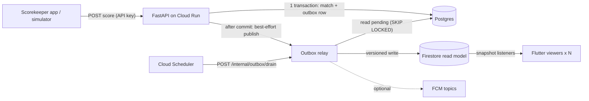

# Pickleball Live Scores API

[](https://github.com/OWNER/REPO/actions/workflows/ci.yml)

Live scores for a pickleball tournament bracket, delivered in under a second to hundreds of
concurrent spectators. The backend is Python on Cloud Run; the reads come from Firestore.

<!-- Demo GIF: Flutter viewer updating live while the simulator runs (to be recorded). -->
> _Demo GIF placeholder: the Flutter viewer updating live while `make simulate` runs._

## Architecture



A score update, end to end:

1. The scorekeeper sends `POST /v1/matches/{id}/points` with the `expected_version` it last saw.
2. In one Postgres transaction the API locks the match (`SELECT ... FOR UPDATE`), checks the
   version (`409` if it moved), applies the scoring rules, bumps `version` and inserts an
   `outbox_events` row with the projected Firestore document. Then it commits.
3. After the response is sent, a background task drains the outbox (the fast path, usually well
   under a second).
4. The relay locks pending events with `FOR UPDATE SKIP LOCKED`, keeps only the newest version
   per match, and writes each document to Firestore only if its version is newer than the stored
   one.
5. If publishing fails, the event stays pending; Cloud Scheduler calls the drain endpoint every
   minute as a safety net.
6. Flutter clients receive the new snapshot through their listeners.

## Why this design

- **Postgres is the source of truth.** Every write goes through the API, which enforces the game
  rules and concurrency in a relational transaction. Clients never write to Firestore.
- **Firestore is the real-time read model.** Clients subscribe with snapshot listeners and get
  pushed updates. Cloud Run serves only short write requests; it holds no long-lived connections,
  so it scales to zero and costs nothing per spectator.
- **Transactional outbox.** The score change and the event that describes it commit together or
  not at all. A crash between "Postgres committed" and "Firestore updated" leaves a pending
  event that the next drain publishes; the two stores cannot silently diverge.
- **Versioned writes.** Every match has a `version`. The publisher writes inside a Firestore
  transaction and skips the write if the stored version is the same or newer. Publishing is
  idempotent, and a delayed publish can never overwrite a newer score.
- **One document per match.** Each update stays small, and writes spread across documents,
  well under Firestore's sustained limit of about one write per second per document.

## Alternatives considered

**Polling (+ CDN).** Clients poll `GET /bracket` every few seconds, cached at the CDN for 1–2 s.
It is simple, robust, and its cost does not grow with update frequency. The trade-offs are
latency equal to the poll interval plus cache TTL, wasted requests when nothing changes, and
cache-invalidation tuning. It remains the best fallback and a strong option at very large scale.

**SSE / WebSockets on Cloud Run.** The API pushes updates directly, with no extra vendor.
However, Cloud Run caps request duration and bills while connections are open; every spectator
holds an instance connection, and fan-out across instances needs a shared broker (Redis pub/sub
or similar). That is a lot of moving parts to rebuild what Firestore listeners already provide.

**FCM as the primary channel.** Push messages reach devices even in the background, but delivery
is best-effort, not ordered, and throttled; it is not meant for a stream of score updates. It is
used here only for a few key moments (match started, final result).

**Managed pub/sub (Ably, Pusher, Centrifugo).** Built for high fan-out with presence, history
and ordering guarantees. It is an extra vendor or service to run, with per-message or
per-connection pricing. It becomes attractive once Firestore read costs dominate (see scaling).
The outbox relay would publish to it instead of, or as well as, Firestore.

## Scaling notes

Details and the cost formula are in [docs/SCALING.md](docs/SCALING.md).

- **Hundreds to ~2k spectators:** this design as is. Firestore read cost for an 8-team
  tournament is cents.
- **~200k spectators:** Firestore bills one read per changed document per listener, so cost grows
  with *updates × viewers*. The levers are:
  - batch updates in 1–2 s windows and keep documents small;
  - have clients listen to a small bracket summary document, plus per-match documents only for
    the live matches the user is actually watching;
  - re-evaluate a dedicated pub/sub service or a CDN-cached snapshot.

## Run it in 5 minutes

Prerequisites: Docker, [uv](https://docs.astral.sh/uv/) and `make`. On Windows without `make`,
each target in the [Makefile](Makefile) is a one-line command you can run directly.

```bash
cp .env.example .env
make up        # Postgres + Firestore emulator (the first run builds the emulator image, ~2-3 min)
make migrate   # create the schema
make run       # terminal 1: API on http://localhost:8000 (docs at /docs)
make relay     # terminal 2: optional; the API already publishes right after each write
make seed      # terminal 3: creates "Demo Open" and prints its id
make simulate ARGS="--tournament <id from seed> --speed 5"
```

Open the Emulator Suite UI at <http://localhost:4000/firestore> (the `seed` output prints a
direct link). Under `tournaments/<id>/matches`, each document's `games` and `version` change
while the simulator runs.

`make simulate` plays each round in parallel, sends points with `expected_version` and retries
on `409`, and can resume a half-played tournament. Add `--verbose` to log every point.

## API overview

Interactive docs: <http://localhost:8000/docs>. Write endpoints need `X-API-Key`; POSTs accept an
optional `Idempotency-Key`.

| Method | Path | Auth | Description |
|---|---|---|---|
| GET | `/health` | – | Liveness |
| GET | `/health/ready` | – | Readiness (checks the database) |
| POST | `/v1/tournaments` | API key | Create a tournament with 4, 8 or 16 teams (seeded in list order) and its bracket |
| GET | `/v1/tournaments/{id}` | – | Tournament with teams |
| GET | `/v1/tournaments/{id}/bracket` | – | All matches grouped by round (initial state / fallback) |
| POST | `/v1/matches/{id}/start` | API key | `pending` → `live`; opens game 1 at 0-0 |
| POST | `/v1/matches/{id}/points` | API key | `{"team": "A" \| "B", "expected_version": n}` |
| PUT | `/v1/matches/{id}/games/{index}` | API key | Correction: `{"a", "b", "expected_version"}` |
| POST | `/internal/outbox/drain` | `X-Internal-Token` | Publish pending events → `{published, failed, remaining}` |

Every error has the same shape:

```json
{ "error": { "code": "version_conflict", "message": "...", "details": { "current_version": 7, "expected_version": 6 } } }
```

Status codes: `401` (missing or invalid key), `404`, `409` (`version_conflict` or
`invalid_state`) and `422` (`validation_error`, `invalid_score`, `invalid_bracket`,
`idempotency_key_reused`).

Firestore documents:
- `tournaments/{id}` holds `name`, `status`, `rounds`, `version` and `updatedAt`.
- `tournaments/{id}/matches/{matchId}` holds `tournamentId`, `round`, `position`, `teamA`,
  `teamB`, `status`, `games`, `winnerTeamId`, `version` and `updatedAt`.

## Testing

```bash
make up && make test   # unit + integration (Postgres and the Firestore emulator from compose)
make lint              # ruff check, ruff format --check, mypy --strict
```

**Unit tests** (no I/O):
- scoring rules: 11-9, deuce, best of 3, corrections;
- bracket generation and advancement for 4, 8 and 16 teams;
- relay coalescing;
- the projector;
- notification texts.

**Integration tests**:
- create a tournament and read its bracket;
- a full match updating both Firestore documents with increasing versions;
- concurrency: same `expected_version` twice gives exactly one `200` and one `409`;
- idempotency: sequential and concurrent retries apply once;
- out-of-order publishing: v5 then v4, and v5 is kept;
- relay failure: the event stays pending with `attempts=1`, and the next drain publishes it;
- notification failures do not block publishing;
- `401` on writes without a key;
- Firestore security rules, loaded into the emulator and exercised as an anonymous client.

The domain package has 100% line coverage.

## Simplifications / out of scope

- **Rally scoring** to 11, win by 2, best of 3. Real pickleball usually uses side-out scoring
  with a server number. Rally scoring keeps the focus on the real-time architecture, and the rule
  lives in one pure module ([app/domain/scoring.py](app/domain/scoring.py)) that is easy to swap.
- **Single elimination with 4, 8 or 16 teams**, no byes. No double elimination or group stage.
- **Shared API key** for scorekeepers instead of Firebase Auth with roles.
- **Public reads** of the read model, so spectators can be signed out.
- Corrections only on live matches; a finished match cannot be reopened.
- No scorekeeper UI (the simulator plays that role), no admin panel, no multi-region, no load
  tests.

## What I'd do next in production

- **Firebase Auth with custom claims** for scorekeepers (per-tournament permissions) instead of a
  shared API key, and App Check on the read side.
- **Rate limiting** per scorekeeper and on the public read endpoints.
- **Tracing with OpenTelemetry** from the HTTP request through the outbox to the Firestore write,
  to measure end-to-end score latency.
- **Dead-letter handling**: events above N attempts move to a dead-letter state with an alert,
  instead of being retried forever.
- **Alerts** on outbox backlog (`remaining`), the age of the oldest pending event, drain failures
  and 5xx rate.
- A scheduled cleanup of `idempotency_keys` older than 24 h, and of published outbox rows.

More context: [docs/DECISIONS.md](docs/DECISIONS.md) (decision log, in Portuguese) and
[docs/DEPLOY.md](docs/DEPLOY.md) (Cloud Run deployment).
